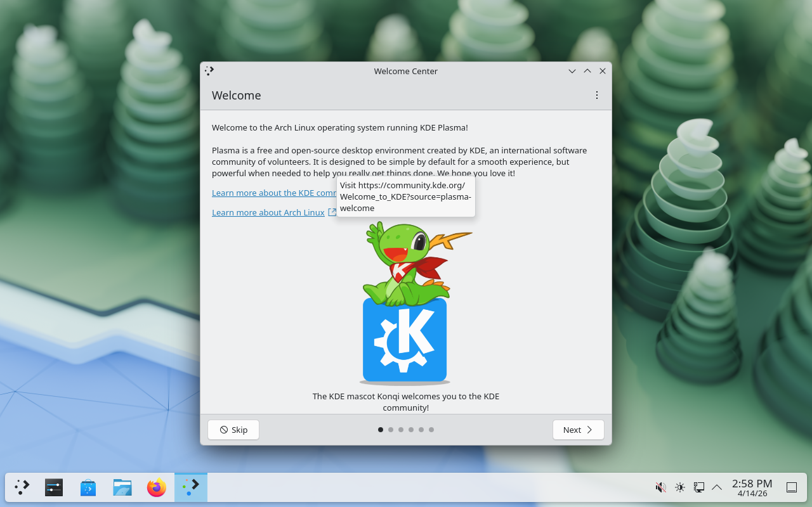

# QuickHatch

**An AI-driven wizard that migrates a Windows workstation to Linux.**

QuickHatch scans your Windows system, asks about your preferences, generates a tailored migration plan using an AI model, and can then SSH into your new Linux machine to install and configure everything for you — desktop environment, drivers, applications, themes, and user accounts.


*KDE Plasma on Arch Linux, fully set up by the QuickHatch agent (LM Studio + Gemma 4 26B) in a VirtualBox VM.*

---

## ⚠️ Security Warning — Read This First

QuickHatch lets an AI model execute shell commands **as root** on a Linux machine via SSH. That carries real risk:

- **A mistaken or malicious command can destroy data.** The agent will try `pacman -Syu`, `rm`, `systemctl`, and similar — if the plan is wrong, so is the execution.
- **Prompt injection is a real threat.** If the AI's web search results or profile data contain adversarial text, the model could be tricked into running unintended commands.
- **Local models are not safer than API models in this respect.** They can hallucinate commands just as easily.
- **Always test against a VM first.** Never point this at a machine with data you can't afford to lose.
- **Review the plan** the agent produces before you hit "Launch agent". The wizard shows the full plan in the UI for a reason.
- **Use a dedicated SSH key** and a target machine with snapshots or backups in place.

This project is experimental. It is NOT recommended for running against your main workstation without a full backup and a tested recovery plan.

---

## What it does

1. **Scans your Windows system** — apps (winget + registry), hardware, installed fonts, browser profiles, disk layout, etc.
2. **Asks your preferences** — desktop style, icon style, wallpaper, use cases (dev/gaming/office/…).
3. **Generates a migration plan** — 6 Markdown cards covering distro, apps, drivers, desktop, migration steps, and a quick-reference summary. Live web search (DuckDuckGo) is used for up-to-date info on drivers, app alternatives, and desktop environments. Screenshots of recommended DEs are fetched and embedded.
4. **Executes the plan remotely** — the agent SSHes into your new Linux machine and runs the commands one at a time, seeing each result and adapting to errors (missing packages, low disk, etc.).

## How it works

```
┌──────────────────┐     ┌────────────────┐     ┌─────────────────┐
│  Windows (host)  │     │   AI provider  │     │  Linux target   │
│                  │     │                │     │                 │
│  QuickHatch GUI  │◄───►│  LM Studio  or │     │                 │
│   (Python HTTP   │     │  Anthropic /   │     │  (live USB or   │
│     + static     │     │  OpenAI / etc  │     │   installed)    │
│      HTML)       │     │                │     │                 │
│                  │     │                │     │    ┌────────┐   │
│  Setup agent ────┼─────┼────────────────┼────►│ SSH│  bash  │   │
│   (Python loop)  │     │                │     │    └────────┘   │
└──────────────────┘     └────────────────┘     └─────────────────┘
```

The setup agent is a proper **agentic loop**: one command at a time, the model sees stdout/stderr/exit code and decides the next step. It can diagnose errors (`xf86-video-vmware` not found → switch to kernel modesetting), adapt to disk constraints, and verify end-state before declaring done.

## Supported AI providers

| Provider | Notes |
|---|---|
| **Claude API** (Anthropic) | Recommended. Use `claude-opus-4-6` or `claude-sonnet-4-6`. |
| **OpenAI API** | `gpt-4o`, `gpt-4o-mini`, `o3`. |
| **LM Studio** (local) | Queries `localhost:1234/v1/models` for your loaded model. Gemma 4 26B works well; 4B struggles with tool use. |
| **Ollama** (local) | Any Ollama-supported model via `localhost:11434`. |
| **Codex CLI** | Launches in a separate terminal. |

## Requirements

- **Host:** Windows 10/11 with Python 3.10+
- **AI:** an API key OR a local model in LM Studio / Ollama
- **Target:** a Linux machine (VM or bare metal) with SSH enabled and your SSH key in `authorized_keys`
- **Recommended:** VirtualBox + a clean Arch/Fedora/Ubuntu VM with snapshots for testing

## Installation

```bash
git clone https://github.com/JanBartos6/QuickHatch.git
cd QuickHatch
pip install -e .
```

## Usage

**Web GUI (recommended):**
```bash
python -m quickhatch --gui
```

**Terminal wizard:**
```bash
python -m quickhatch
```

**Demo mode** (loads a sample profile, for testing on Linux):
```bash
python -m quickhatch --gui --demo
```

## Testing against a VM

The recommended way to try QuickHatch without risk is to spin up a VirtualBox VM:

```bash
# Create a VM with 8GB RAM, 4 CPUs, 40GB disk, EFI firmware
# Boot from an Arch/Fedora/Ubuntu ISO
# Install the OS (or use the included install script as a starting point)
# Add your SSH public key to /root/.ssh/authorized_keys
# Take a snapshot
# In QuickHatch, enter 127.0.0.1:2222 as the IP, root as the user, launch agent
```

See `docs/testing-in-vm.md` (WIP) for detailed steps.

## Limitations

- GPU passthrough is not handled — NVIDIA drivers will install on bare metal but not inside VirtualBox with VMSVGA.
- No Wayland-specific mouse integration for VirtualBox; the agent works via SSH but manual GUI testing inside the VM may need Guest Additions.
- The setup agent requires SSH key authentication. Password-only SSH is not supported.
- Multi-distro support is real but Arch is the most tested (it has the fewest installer crutches, so if it works on Arch it works everywhere).

## Project status

Experimental. The analysis pipeline and setup agent both work end-to-end against a real Arch VM (verified: 863 packages installed, KDE Plasma + Firefox + LibreOffice + GIMP + VLC + audio stack, all from a single `Launch agent` click). Expect rough edges around:

- Error recovery in the middle of large installs
- Multi-user system configuration
- Wayland-only DEs and display manager quirks

Contributions welcome — see `CONTRIBUTING.md` (coming soon).

## License

[MIT](LICENSE)

---

*QuickHatch is not affiliated with Anthropic, OpenAI, LM Studio, System76, or any Linux distribution.*
